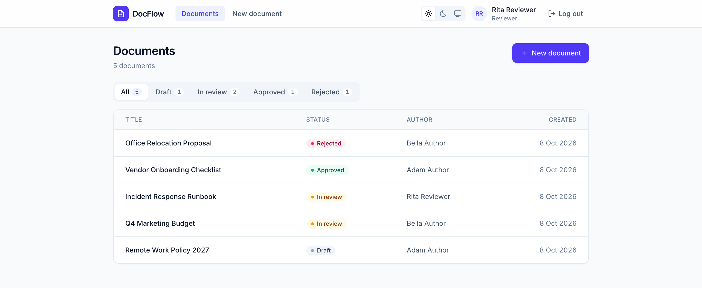
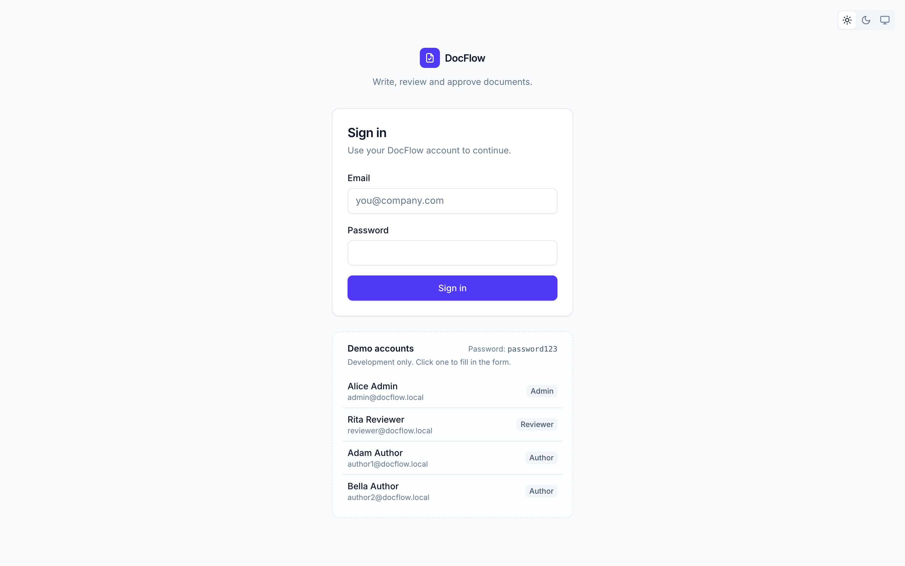
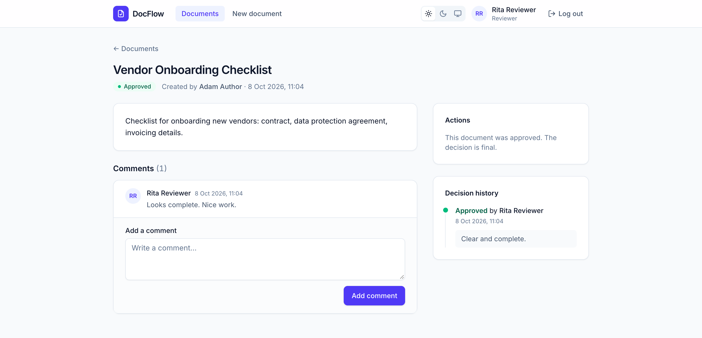
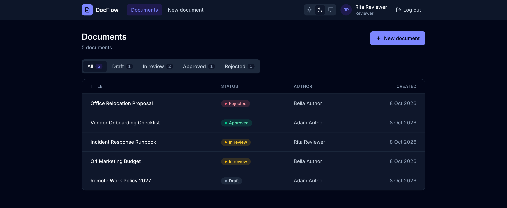

# DocFlow – Document Approval Workflow Platform

[](https://github.com/DariusCristian/document-approval-workflow-platform/actions/workflows/ci.yml)


DocFlow is a full-stack web application for writing documents and getting them approved. Authors write documents and submit them for review, reviewers approve or reject them, and everyone can discuss a document in its comments. Every decision is recorded, so each document has a complete, tamper-proof approval history.

The project focuses on what makes a business application trustworthy: **real authentication and authorization, enforced business rules, correct behaviour under concurrent use, and an automated test suite** that proves it.



---

## Highlights

- **Session-based authentication** with Spring Security 7: HttpOnly session cookies, session-fixation protection and CSRF protection (including on login).
- **The server decides who you are.** Requests never carry user IDs; the backend takes the user from the session, so nobody can act as someone else.
- **Role-based rules and the four-eyes principle.** Only reviewers and admins can decide, and nobody, admins included, can approve their own document.
- **A workflow that can't be bypassed.** Documents can only be approved or rejected through a recorded decision, never by editing the status directly.
- **Concurrency-safe decisions** using optimistic locking (`@Version`). If two reviewers decide at the same moment, only one wins and the other gets a clear `409 Conflict`.
- **75 backend tests + 24 frontend tests**, including integration tests against a real PostgreSQL in Docker (Testcontainers) and a deterministic test for a race condition. About **80% line coverage**.
- **A polished, responsive UI** built with Tailwind CSS v4 and a small set of in-house components, with **dark mode**.
- **Continuous integration** with GitHub Actions on every push and pull request to `main`.

---

## Screenshots

| Sign in | Documents |
|---|---|
|  |  |

| Document detail | Dark mode |
|---|---|
|  |  |

---

## The workflow

```text
DRAFT ──(author submits)──> IN_REVIEW ──(reviewer/admin decides)──> APPROVED
                                                               └──> REJECTED
```

- New documents start as **DRAFT**.
- Only the document's author can submit it for review (**DRAFT → IN_REVIEW**).
- A **REVIEWER** or **ADMIN** approves or rejects an IN_REVIEW document by recording a decision, optionally with a comment. This sets the status to **APPROVED** or **REJECTED**.
- APPROVED and REJECTED are final.
- Anyone who is logged in can comment on any document.

### Roles

| Action | ADMIN | REVIEWER | AUTHOR |
|---|:---:|:---:|:---:|
| Create, list and view documents | ✅ | ✅ | ✅ |
| Comment on documents | ✅ | ✅ | ✅ |
| Submit **own** draft for review | ✅ | ✅ | ✅ |
| Approve or reject **others'** documents | ✅ | ✅ | ❌ |
| Approve or reject **own** documents | ❌ | ❌ | ❌ |
| Create users | ✅ | ❌ | ❌ |

---

## Features

- Sign in and sign out, with the current user loaded from the server on every page load
- Documents list with status filter tabs (the filter is kept in the URL), shown as a table on desktop and as cards on phones
- Document detail page with content, an actions panel, a decision-history timeline and comments
- Actions and hints that depend on the user's role and the document's status, for example *"You can't review your own document"*
- Names and readable dates everywhere (`8 Oct 2026, 14:32`) instead of raw IDs and timestamps
- Loading skeletons, empty states and clear error messages, including *"Your session expired"*
- Light, dark and system theme, without a flash of the wrong theme on load
- Consistent JSON errors from the API: `{ "status": 403, "message": "..." }`
- Demo accounts and sample documents for local development, plus a one-command database reset

---

## Tech stack

| Backend | Frontend | Testing & tooling |
|---|---|---|
| Java 21 | React 19 + TypeScript | JUnit 6, MockMvc, spring-security-test |
| Spring Boot 4 | Vite | Testcontainers (PostgreSQL) |
| Spring Security 7 (sessions, CSRF) | React Router 7 | JaCoCo coverage |
| Spring Data JPA / Hibernate | Tailwind CSS v4 | Vitest + React Testing Library |
| PostgreSQL 17 | Inter font (self-hosted) | ESLint |
| Flyway migrations | | GitHub Actions |
| Gradle | | |

---

## Architecture

```text
┌──────────────────────────┐      /api/* (proxied by Vite in development)      ┌───────────────────────────┐
│  React + TypeScript SPA  │ ───────────────────────────────────────────────▶  │  Spring Boot REST API     │
│  localhost:5173          │   session cookie (HttpOnly) + X-XSRF-TOKEN header │  localhost:8080           │
└──────────────────────────┘                                                   └─────────────┬─────────────┘
                                                                                             │ JPA / Hibernate
                                                                                             ▼
                                                                               ┌───────────────────────────┐
                                                                               │  PostgreSQL 17            │
                                                                               │  schema managed by Flyway │
                                                                               └───────────────────────────┘
```

The backend is organized **by feature**. Each feature package (`approval`, `comment`, `document`, `user`) has the same four layers:

```text
domain/      → JPA entities and enums
repository/  → Spring Data JPA repositories
service/     → business rules, permissions and transactions
web/         → REST controllers and request/response DTOs
```

A request flows like this: the controller receives JSON → `@Valid` checks the request DTO → the service applies the business and permission rules → the repository talks to PostgreSQL → the controller maps the result to a response DTO.

---

## Security design

### Session-based authentication

- `POST /api/auth/login` checks the password (BCrypt) and stores the user in a server-side HTTP session. The browser only holds an **HttpOnly** `JSESSIONID` cookie, which JavaScript can't read.
- The session ID changes on login, which prevents **session fixation**.
- Every endpoint except login and the CSRF-token endpoint requires a session; without one the API returns `401`.

**Why sessions instead of JWT?** The app has one backend and a frontend served from the same origin, so JWT's main advantage (stateless scaling across services) doesn't apply. Sessions give immediate server-side logout, and a login that injected JavaScript can't steal. The trade-off is that cookie-based auth needs CSRF protection, described below.

### The server decides who you are

Request bodies never contain user IDs. When a document, comment or decision is created, the backend takes the author from the session. Even if a client sends `"authorId": 99`, it is ignored. The frontend also asks `GET /api/auth/me` on load, instead of trusting anything stored in the browser.

### Role rules in the service layer

All permission checks live in the services and throw a dedicated `ForbiddenException`, which becomes a `403` with a specific message (for example *"You cannot approve or reject your own document."*). The service layer was chosen over `@PreAuthorize` annotations because several rules need data first (who wrote this document?) and because each rule gets its own clear message.

### CSRF protection

Spring Security's SPA CSRF support puts a random token in an `XSRF-TOKEN` cookie, and the frontend sends it back in an `X-XSRF-TOKEN` header on every POST, PUT, PATCH and DELETE. Another website can make the browser *send* cookies, but it can't *read* them, so it can't forge the header. Login is protected too, which prevents **login CSRF** (an attacker logging you into their account).

---

## Data and concurrency

### Avoiding N+1 queries

Responses include names (`createdByName`, `authorName`, `decidedByName`). The user relations are lazy, so loading names naively would run one extra query per row. The repositories use `@EntityGraph` to load the related user in the **same query** with a join. This also avoids `LazyInitializationException`, since `open-in-view` is turned off.

### Optimistic locking

Every document has a `version` column (`@Version`). When Hibernate saves a change, it only updates the row if the version is still the one it read, and increments it in the same statement. If two reviewers decide on the same document at the same moment, the second save finds a newer version, the whole transaction (including the new decision) is rolled back, and the API returns:

```json
{ "status": 409, "message": "This document was just updated by someone else. Please reload and try again." }
```

The frontend then shows that message and reloads the document. Optimistic locking fits here better than row locks: conflicts are rare, nobody has to wait, there's no deadlock risk, and every future change to a document is protected automatically.

Recording a decision is also `@Transactional`: the decision and the status change are saved together, or not at all.

---

## Getting started

### Prerequisites

- **Java 21**
- **Node.js** 22.13+, 24 or 26+ (CI uses 24)
- **PostgreSQL** running on `localhost:5432`, with the `psql`, `createdb` and `dropdb` command-line tools
- **Docker** (only to run the backend tests), for example [OrbStack](https://orbstack.dev) or Docker Desktop

### 1. Database

```bash
./scripts/reset-db.sh
```

This creates the `docflow_user` role if needed, then **drops and recreates** the `docflow_db` database. Stop the backend before running it. Connection settings are in `backend/src/main/resources/application.yml`.

### 2. Backend

```bash
cd backend
./gradlew bootRun
```

The API starts on http://localhost:8080 with the `dev` profile. Flyway creates the tables, and if the database has no users yet, demo accounts and sample documents are added.

### 3. Frontend

```bash
cd frontend
npm install
npm run dev
```

Open http://localhost:5173. The Vite dev server forwards `/api` requests to the backend, so the browser sees a single origin.

### Demo accounts

All demo accounts use the password **`password123`**. In development, the login page lists them, and clicking one fills in the form.

| Email | Name | Role |
|---|---|---|
| `admin@docflow.local` | Alice Admin | ADMIN |
| `reviewer@docflow.local` | Rita Reviewer | REVIEWER |
| `author1@docflow.local` | Adam Author | AUTHOR |
| `author2@docflow.local` | Bella Author | AUTHOR |

The seed data has one document in each status, including an IN_REVIEW document written by the reviewer, so you can try the four-eyes rule right away.

---

## Tests

```bash
# Backend: unit and integration tests (requires Docker)
cd backend
./gradlew test

# Frontend: Vitest + React Testing Library
cd frontend
npm test            # run once
npm run test:watch  # re-run on file changes
```

- The coverage report is written to `backend/build/reports/jacoco/test/html/index.html`.
- The frontend tests need no backend: API calls are mocked.
- **CI:** GitHub Actions runs the backend tests and the frontend lint, tests and build on every push and pull request to `main` (`.github/workflows/ci.yml`). Each run's coverage report can be downloaded as the `jacoco-report` artifact.

### What is tested

- **Authentication:** 401 without a session, correct and wrong passwords, `/me`, logout ending the session, validation of empty login fields
- **CSRF:** state-changing requests without the token are rejected; with the token they succeed
- **Identity:** user IDs sent in request bodies are ignored; the logged-in user is always used
- **Role rules:** authors can't decide; nobody can decide on their own document (admins included); only admins can create users
- **Workflow:** only the author submits a draft; status can't be set to APPROVED or REJECTED directly; decisions require IN_REVIEW and appear in the history
- **Consistency:** a decision is all-or-nothing, and a concurrent decision gets `409` with only one decision stored. The race is reproduced deterministically by pausing one request while another completes.
- **API responses:** names are filled in, newest documents come first, missing documents give `404`, validation errors give `400` in the standard JSON shape
- **Frontend:** date formatting, status labels, and which actions each role sees on the detail page

### How the backend tests work

- Integration tests run against a **real PostgreSQL 17** started by Testcontainers. One container is shared by all test classes to keep the suite fast, and the local development database is never touched.
- Every table is truncated before each test, instead of rolling back a transaction. This lets each request commit exactly as it would in production, so problems like lazy-loading errors or partial saves can't be hidden by the test setup.
- The status-transition rules are also covered by plain unit tests, with no Spring and no database.

---

## API overview

All endpoints are under `/api`, return JSON, and (except login and the CSRF token) require a session. State-changing requests require the `X-XSRF-TOKEN` header.

| Method | Endpoint | Description |
|---|---|---|
| `GET` | `/auth/csrf` | Issue a CSRF token cookie |
| `POST` | `/auth/login` | Sign in |
| `POST` | `/auth/logout` | Sign out |
| `GET` | `/auth/me` | Current user |
| `GET` | `/users` | List users |
| `GET` | `/users/{id}` | Get one user |
| `POST` | `/users` | Create a user (ADMIN only) |
| `GET` | `/documents` | List documents, newest first |
| `POST` | `/documents` | Create a document (as DRAFT) |
| `GET` | `/documents/{id}` | Get one document |
| `PATCH` | `/documents/{id}/status` | Submit for review (author only, DRAFT → IN_REVIEW) |
| `GET` | `/documents/{id}/comments` | List comments |
| `POST` | `/documents/{id}/comments` | Add a comment |
| `GET` | `/documents/{id}/decisions` | Decision history |
| `POST` | `/documents/{id}/decisions` | Approve or reject (REVIEWER/ADMIN, not own document) |

---

## Project structure

```text
.
├── .github/workflows/ci.yml        CI: backend tests, frontend lint, tests and build
├── backend/                        Spring Boot application
│   ├── build.gradle
│   └── src/
│       ├── main/java/com/docflow/backend/
│       │   ├── approval/           approval decisions
│       │   ├── auth/               login, logout, /me, CSRF token
│       │   ├── comment/            document comments
│       │   ├── common/             exceptions and global JSON error handler
│       │   ├── config/             security configuration, dev data seeder
│       │   ├── document/           documents and the status workflow
│       │   ├── security/           user details and principal
│       │   └── user/               users and roles
│       ├── main/resources/
│       │   ├── application.yml
│       │   └── db/migration/       Flyway migrations V1–V6
│       └── test/java/…             unit and integration tests
├── frontend/                       React application
│   └── src/
│       ├── api/                    fetch client (CSRF header, 401 handling) and API calls
│       ├── app/                    auth context, page titles, theme
│       ├── components/             layout and shared UI components
│       ├── pages/                  Login, Documents, New document, Document detail
│       ├── utils/                  date formatting, status labels
│       └── test/                   test setup
└── scripts/
    └── reset-db.sh                 resets the local development database
```

---

## Possible next steps

- End-to-end tests (e.g. Playwright) that drive the real frontend against the real backend
- Docker Compose to start PostgreSQL, the backend and the frontend with one command
- A live demo deployment
- File attachments (real documents stored in object storage such as S3 or MinIO)
- Multi-step approvals with several reviewers
- Email or in-app notifications when a document needs review

---

## Author

Built by **Darius** · [GitHub](https://github.com/DariusCristian) · [Portfolio](https://dariuscristian.github.io)
